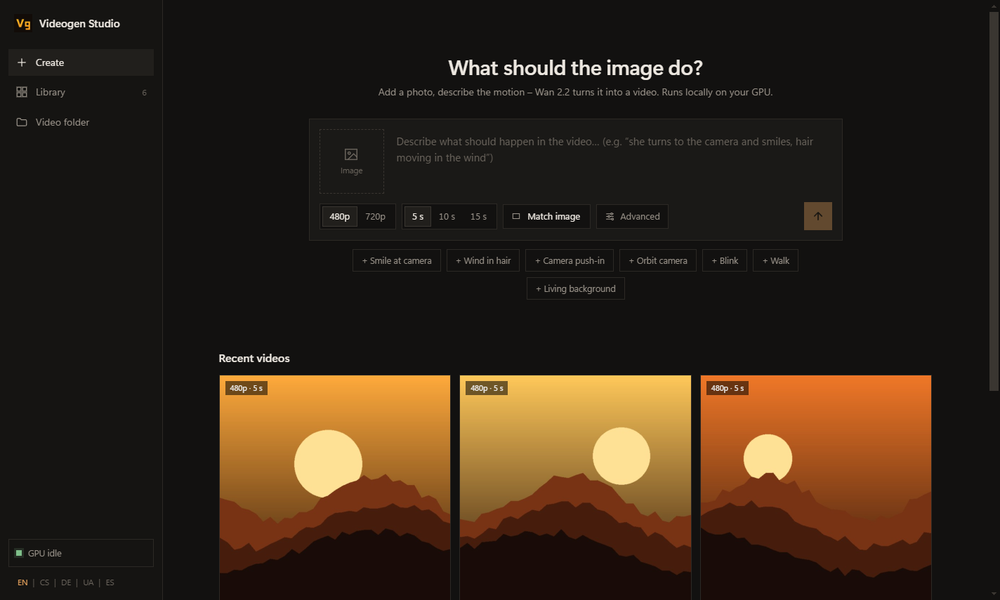

<p align="center">
  
</p>

<h1 align="center">Videogen Studio</h1>

<p align="center">
  Local image-to-video generation with <b>Wan 2.2 A14B</b> – a lightweight desktop app, no ComfyUI.<br>
  Runs on AMD (ROCm) or NVIDIA (CUDA) on Windows.
</p>

<p align="center">
  
</p>

## Why

ComfyUI is great, but for one job – *turn this picture into a 5–15 s video* – it is a lot of
machinery. Videogen Studio is a small alternative with no build step: a plain `diffusers` pipeline, a tiny
standard-library HTTP server with a job queue, and an Electron shell. Everything runs locally;
nothing leaves your machine.

## Features

- **Image → video** with Wan 2.2 I2V A14B (both the high-noise and the low-noise expert), 480p or 720p
- **Fast mode** – 4 steps with the lightx2v distillation LoRA (fused into the weights, no runtime cost)
- **Longer videos** (10 s, 15 s) built from chained segments, each continuing from the last frame
- **Your own LoRAs** – drop `…high…` / `…low…` `.safetensors` pairs into `models/loras`
- **Job queue** with live progress, honest time estimates and "starts in / takes" for queued jobs
- **Library** – every video keeps its prompt, seed and settings; "Again" and "Edit" re-run them
- **Crash-safe** – unfinished segments are kept as a *partial* video instead of being lost;
  if the server dies, the generator stops too and frees the GPU memory
- **Desktop niceties** – taskbar progress, notifications, Save as…, keyboard navigation
- **UI in English, Czech, German, Ukrainian and Spanish** (follows the system language, switchable in the sidebar)
- **Mock mode** to work on the UI without a GPU

## Requirements

| | |
|---|---|
| GPU | ~64 GB of VRAM for the two 14B experts in bf16 (peak ~62 GB at 480p) |
| OS | Windows 11 (ROCm 7.x). The desktop app and the `.bat` launchers are Windows-only; `generate.py` and `server.py` are OS-agnostic. |
| Disk | ~72 GB for the models |
| Software | Python 3.12, PyTorch with ROCm (or CUDA), Node.js (only to install Electron) |

## Installation

```bat
git clone https://github.com/Danieljsem/videogen-studio-uncensored.git
cd videogen-studio-uncensored
python -m venv venv
```

1. **PyTorch** – install a ROCm build for your GPU first (for gfx1151 the nightly wheels from
   [AMD TheRock](https://github.com/ROCm/TheRock)), or a CUDA build on NVIDIA.
2. **Python packages**
   ```bat
   venv\Scripts\pip install -r requirements.txt
   ```
3. **Models** – from [Comfy-Org/Wan_2.2_ComfyUI_Repackaged](https://huggingface.co/Comfy-Org/Wan_2.2_ComfyUI_Repackaged)
   (`split_files/…`) into `models/`:

   | Folder | File | Size |
   |---|---|---|
   | `models/diffusion_models` | `wan2.2_i2v_high_noise_14B_fp16.safetensors` | 28.6 GB |
   | `models/diffusion_models` | `wan2.2_i2v_low_noise_14B_fp16.safetensors` | 28.6 GB |
   | `models/text_encoders` | `umt5_xxl_fp16.safetensors` | 11.4 GB |
   | `models/vae` | `wan_2.1_vae.safetensors` | 0.3 GB |
   | `models/loras` | `wan2.2_i2v_lightx2v_4steps_lora_v1_high_noise.safetensors` + `…_low_noise.safetensors` | 2 × 1.2 GB |

   Plus the configs and tokenizer only (no weights) from the official Diffusers repo:
   ```bat
   venv\Scripts\hf download Wan-AI/Wan2.2-I2V-A14B-Diffusers --include "*.json" "tokenizer/*" --local-dir models/diffusers-config
   ```
4. **Desktop app**
   ```bat
   cd studio && npm install
   ```

> **ROCm settings.** `generate.bat`, `dev/run.ps1` and the desktop app set `HIP_PATH`,
> `PYTORCH_ROCM_ARCH=gfx1151` and `HSA_OVERRIDE_GFX_VERSION=11.5.1` (AMD gfx1151 defaults). On another AMD
> GPU adjust them (the desktop app keeps values already set in your environment); on NVIDIA remove them.

## Usage

**Desktop app** – run `studio.bat`. Add an image, describe the motion (English works best), pick
480p/720p and 5/10/15 s, press ↑ or Ctrl+Enter.

**Browser** – `venv\Scripts\python server.py`, then open <http://127.0.0.1:7870>.
(Set the ROCm environment variables from `generate.bat` first.)

**Command line**
```bat
generate.bat photo.jpg "she turns to the camera and smiles, hair moving in the wind" --res 480 --sec 5
```

| Option | Default | |
|---|---|---|
| `--res 480\|720` | 480 | target area 480×832 or 720×1280, aspect ratio from the image |
| `--sec` | 5 | total length; more than `--seg` = chained segments |
| `--seg` | 5 | length of one segment |
| `--steps` | 4 | ≤ 8 uses the 4-step LoRA (cfg 1.0); more = full model with cfg 3.5, two passes per step (50 steps ≈ 25× slower) |
| `--cfg` | 1.0 / 3.5 | guidance scale override |
| `--neg` | official Wan negative prompt | negative prompt |
| `--out` | `output/wan_<time>_<seed>.mp4` | output file |
| `--seed` | random | |
| `--lora HIGH LOW STRENGTH` | | repeatable, a high/low pair for the two experts |

**UI without a GPU** – `set WAN_MOCK=1` before starting; a fake generator writes test videos to `test/mock_output`.

## Recommended settings

| Your GPU memory | Start with | Then try |
|---|---|---|
| ~64 GB | **480p, 5 s, 4 steps** – the safe default | 10–15 s at 480p (segments are rendered one after another, so memory use stays the same) |
| more than 64 GB | 480p, 5 s to check the motion and prompt | 720p and longer videos once you like the result |

Start small: a 480p 5 s clip is the quickest way to tune the prompt and the seed. 720p needs extra
memory on top of the ~58 GB of model weights and takes roughly 5× longer per second of video, so
only switch to it when you have headroom.

## Performance

Rendering time depends mostly on the number of video tokens, (width/16)·(height/16)·(1 + (frames−1)/4)
per segment: a 480p 5 s clip has ~31 k tokens, a 720p 5 s clip ~74 k. Attention cost grows with the *square* of the token count, so 720p is ~5× slower than 480p per
second of video. For speed, render at 480p and upscale afterwards. The app's estimates use this
model and calibrate themselves from your finished videos.

## How it works

```
studio/ (Electron) ──starts──▶ server.py ──runs one job at a time──▶ generate.py
   splash, taskbar,             HTTP API + queue,                     diffusers WanImageToVideoPipeline,
   notifications                progress from the log,                weights loaded straight into VRAM,
                                metadata next to each video           text encoder freed after encoding
```

- **Memory** – weights are loaded from disk directly into VRAM (`from_single_file(device="cuda")`),
  so the two 28.6 GB experts never have to fit in system RAM.
- **Attention on AMD gfx1151** – `TORCH_ROCM_AOTRITON_ENABLE_EXPERIMENTAL=1` enables flash attention;
  without it PyTorch falls back to math attention and runs out of memory.
- **Security** – the server listens on 127.0.0.1 only and rejects requests from other origins.

## Project structure

```
generate.py         the pipeline (CLI)
server.py           HTTP server, job queue, library
mock_generate.py    fake generator for UI work
web/index.html      the whole UI (no build step, no dependencies)
studio/             Electron shell (main.js, preload.js, splash.html, icons)
dev/                diagnostics: env smoke test, attention / VAE benchmarks, VRAM info, UI smoke test
```

## Credits

- [Wan 2.2](https://github.com/Wan-Video/Wan2.2) by Wan-AI (Apache 2.0)
- [lightx2v](https://github.com/ModelTC/lightx2v) 4-step distillation LoRA
- [Comfy-Org](https://huggingface.co/Comfy-Org) for the single-file repackaged weights
- [🤗 Diffusers](https://github.com/huggingface/diffusers)

The app icon is drawn in code from plain shapes (`studio/icon.py`) and is MIT-licensed like the rest.
The models are not part of this repository and are covered by their own licenses.
You are responsible for what you generate – don't create content of real people without their consent.

## License

[MIT](LICENSE) © 2026 Danieljsem
