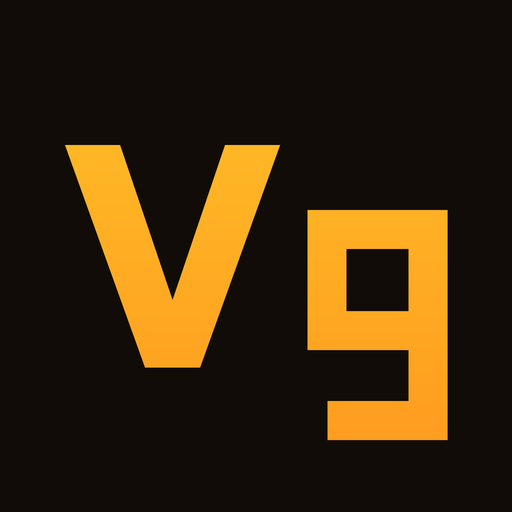
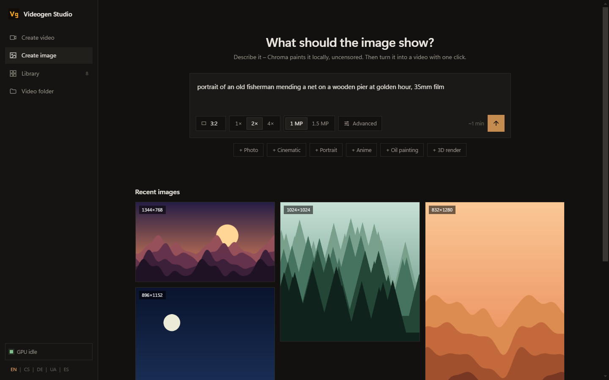
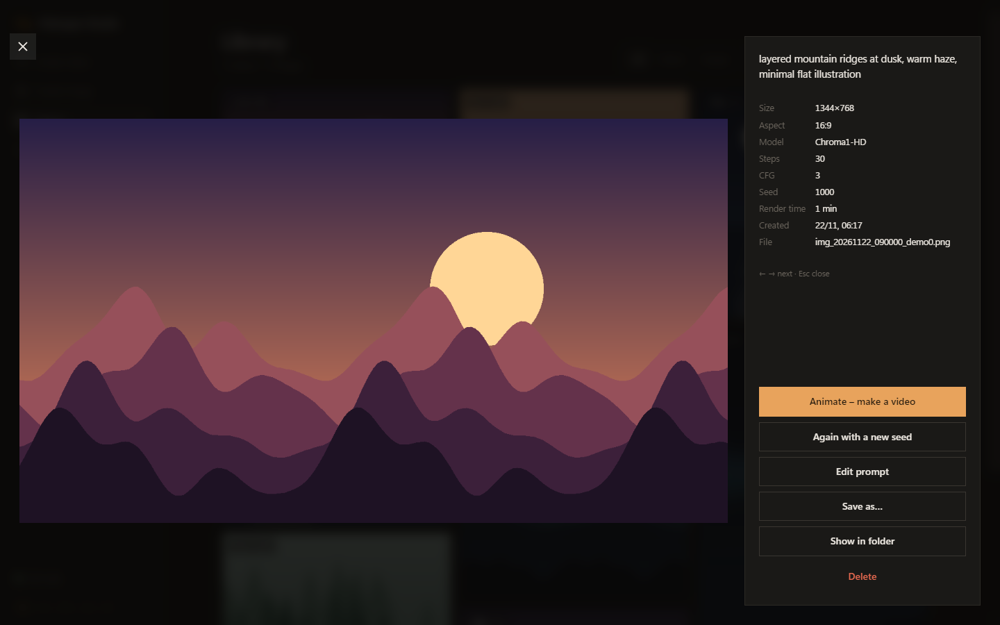
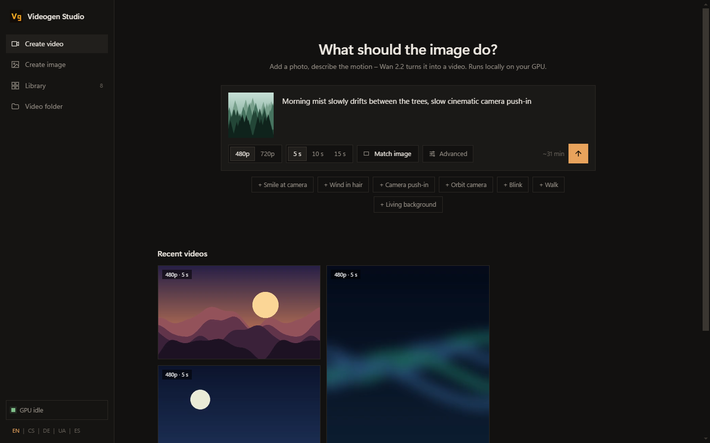
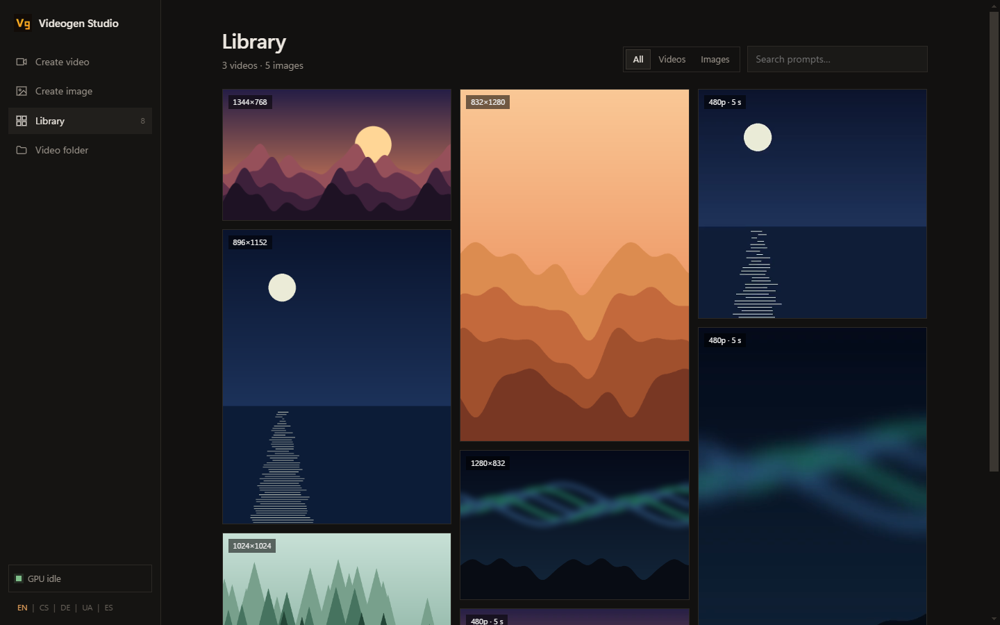
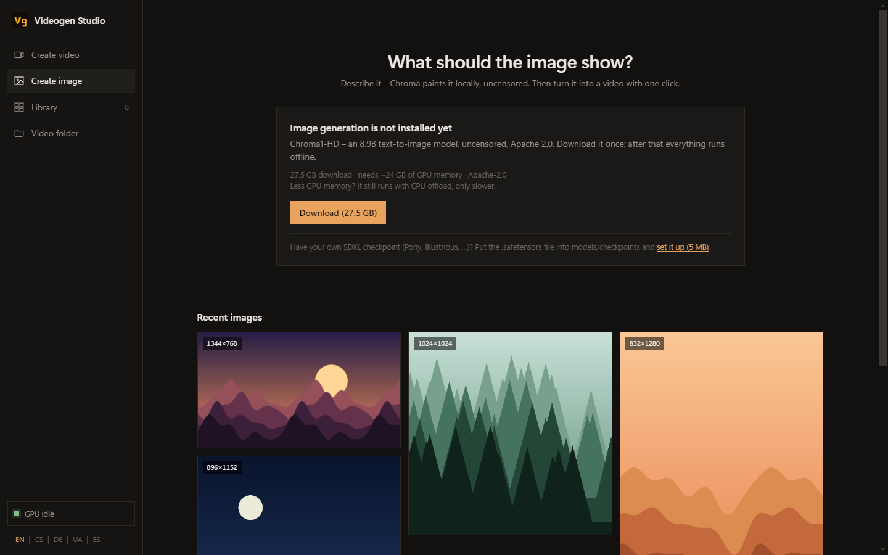

<p align="center">
  
</p>

<h1 align="center">Videogen Studio</h1>

<p align="center">
  <b>Uncensored image and video generation on your own GPU.</b><br>
  Text → image with <b>Chroma1-HD</b>, image → video with <b>Wan 2.2 A14B</b>. One installer, a clean desktop app, no ComfyUI, no cloud.
</p>

<p align="center">
  <a href="https://github.com/Danieljsem/videogen-studio-uncensored/releases/latest"></a>
  
  
  <a href="LICENSE"></a>
</p>

<p align="center">
  
</p>

> **Get notified about new versions:** click **Watch → Custom → Releases** at the top of this page.
> A star alone doesn't send notifications.

## What's new in 2.0

- **Text → image, uncensored.** [Chroma1-HD](https://huggingface.co/lodestones/Chroma1-HD) (8.9B, Apache 2.0) is built in, and you can drop in your own **SDXL checkpoints** (Pony, Illustrious and other fine-tunes).
- **Animate any image** you create: one click makes it the input of a Wan 2.2 video.
- **One-click installer for Windows and Linux.** It picks the right PyTorch for your GPU (CUDA, ROCm or CPU), keeps everything inside the app folder and creates a shortcut. No Python, Node.js or Git setup needed.
- **Download models from inside the app**, with progress, stop and resume. Nothing has to be fetched by hand any more.
- One library for videos and images, with filters and the same *Again* / *Edit* workflow for both.

Full list in the [changelog](CHANGELOG.md).

## Features

| | |
|---|---|
| **Create image** | Chroma1-HD or your SDXL checkpoints · 7 aspect ratios · 1 or 1.5 MP · batches of 1, 2 or 4 · steps, CFG, seed, negative prompt · style chips |
| **Create video** | Wan 2.2 I2V A14B with both experts · 480p or 720p · 5, 10 or 15 s (chained segments) · fast 4-step mode · your own LoRA pairs |
| **Queue** | One GPU job at a time, live progress, time estimates that calibrate themselves from your finished jobs |
| **Library** | Every result keeps its prompt, seed and settings · *Again*, *Edit*, *Animate*, *Save as…* · search and filter |
| **Robust** | Finished images and video segments are kept if something crashes; when the app closes, the generator stops and frees GPU memory |
| **Private** | Runs on `127.0.0.1` only; once the models are downloaded, nothing leaves your machine |
| **Languages** | English, Czech, German, Ukrainian, Spanish (follows your system, switchable) |

## Requirements

| | Image: Chroma1-HD | Image: SDXL checkpoint | Video: Wan 2.2 A14B |
|---|---|---|---|
| GPU memory | **24 GB** for full speed; 12–16 GB works with automatic CPU offload (slower, needs ~32 GB RAM) | 8 GB+ | **~64 GB** (two 14B experts in bf16) |
| Download | 27.5 GB | your checkpoint + 5 MB of configs | 71 GB |

- **OS:** Windows 10/11 or Linux x86_64.
- **GPU:** NVIDIA with a recent driver (580+, CUDA 13 build of PyTorch), or AMD: ROCm on Linux, AMD's TheRock PyTorch builds on Windows (preview: Radeon RX 7000/9000, Ryzen AI 300 and Ryzen AI Max).
- **Disk:** ~6 GB for the app and PyTorch, plus the models you choose.

Not sure your GPU is enough? The installer tells you what it found and which features fit. Image generation runs on much smaller GPUs than video.

## Install

**Windows:** [download the ZIP](https://github.com/Danieljsem/videogen-studio-uncensored/archive/refs/heads/main.zip), unzip it, double-click **`install.bat`**.
Or in PowerShell:

```powershell
git clone https://github.com/Danieljsem/videogen-studio-uncensored.git; cd videogen-studio-uncensored; .\install.bat
```

**Linux:**

```bash
git clone https://github.com/Danieljsem/videogen-studio-uncensored.git && cd videogen-studio-uncensored && ./install.sh
```

The installer runs six steps and can be run again at any time (finished steps are skipped):

1. a private Python 3.12 via [uv](https://github.com/astral-sh/uv), inside the app folder
2. PyTorch for your GPU, detected automatically
3. the Python packages
4. a GPU check that tells you which features fit in your GPU memory
5. the desktop app (Electron, downloaded and checksum-verified, no Node.js needed) and a desktop / app-menu shortcut
6. models: image, video, both, or *later from the app*

<details>
<summary>Installer options</summary>

| Windows (`install.bat …`) | Linux (`./install.sh …`) | |
|---|---|---|
| `-Gpu nvidia\|amd\|cpu` | `--gpu nvidia\|amd\|cpu` | override GPU detection |
| `-TorchIndex <url>` | `--torch-index <url>` | use a specific PyTorch wheel index |
| `-Models image,video` or `-Models none` | `--models image,video` or `--models none` | download now / skip |
| `-NoShortcut` | | no desktop shortcut |
| `-Yes` | `--yes` | no questions |

Models can also be fetched from a terminal: `python download_models.py image video` (resumes, skips finished files).
</details>

**Updating from 1.x:** `git pull`, then run the installer once. Your models and library stay where they are.

## Using it

Start **Videogen Studio** from the desktop shortcut or app menu, or run `studio.bat` / `./studio.sh`.
Without the desktop app, the same UI opens in your browser at <http://127.0.0.1:7870>.

**Create image:** describe the picture (English works best), pick the aspect ratio and how many images, press ↑ or Ctrl+Enter.
The first time, the app offers to download Chroma1-HD.

<p align="center"></p>

**Animate:** open an image in the library and press **Animate – make a video**. It becomes the input in *Create video*; describe the motion and go.

<p align="center"></p>

**Create video:** add any photo or image (drag and drop, Ctrl+V), describe the motion, pick 480p or 720p and 5, 10 or 15 s.

<p align="center"></p>

<details>
<summary>More screenshots: library, model download inside the app</summary>
<p align="center"></p>
<p align="center"></p>
</details>

<sub>The pictures in the screenshots are placeholder illustrations drawn in code, not model output.</sub>

### Your own models

- **SDXL checkpoints:** put `.safetensors` files into `models/checkpoints/`, click *set it up (5 MB)* once in Create image (or run `python download_models.py sdxl`), and they appear under *Advanced → Model*.
- **Video LoRAs:** put Wan 2.2 `…high…` / `…low…` `.safetensors` pairs into `models/loras/`; they appear under *Advanced* in Create video.

### Command line

```bash
# text -> image
python generate_image.py "a lighthouse in a storm, oil painting" --aspect 16:9 --count 4
# image -> video
python generate.py photo.jpg "she turns to the camera and smiles, hair moving in the wind" --res 480 --sec 5
```

Use `venv\Scripts\python` on Windows or `venv/bin/python` on Linux, or the `generate.bat` / `generate_image.bat` / `generate.sh` wrappers.

| `generate_image.py` | default | `generate.py` | default |
|---|---|---|---|
| `--aspect` | 1:1 | `--res 480\|720` | 480 |
| `--mp 1.0\|1.5` | 1.0 | `--sec` | 5 (longer = chained segments) |
| `--count` | 1 | `--steps` | 4 (≤ 8 uses the 4-step LoRA) |
| `--steps` | 30 Chroma, 28 SDXL | `--cfg` | 1.0 fast, 3.5 full |
| `--cfg` | 3.0 Chroma, 5.0 SDXL | `--lora HIGH LOW STRENGTH` | repeatable |
| `--model` | `chroma` or a file in `models/checkpoints` | `--neg`, `--seed`, `--out` | |
| `--offload auto\|on\|off` | auto (on below ~22 GB) | | |

## Recommended settings

| | Start with | Then |
|---|---|---|
| Image | 1 MP, 30 steps, CFG 3, a batch of 2–4 to pick from | 1.5 MP or 40 steps for the keeper |
| Video | **480p, 5 s, 4 steps**: the quickest way to tune the motion prompt | 10–15 s at 480p (segments render one after another, memory stays the same); 720p only with memory to spare above 64 GB |

Video render time depends on the number of video tokens, (width/16)·(height/16)·(1 + (frames−1)/4) per segment, and attention cost grows with its square: 720p is roughly 5× slower than 480p per second of video. For speed, render at 480p and upscale afterwards.

## Troubleshooting

| Problem | Fix |
|---|---|
| "PyTorch does not see a GPU" | NVIDIA: update the driver (580+). AMD on Linux: `sudo usermod -aG render,video $USER`, log out and in. Then run the installer again. |
| AMD GPU not officially supported by ROCm | Add `HSA_OVERRIDE_GFX_VERSION=11.0.0` (RDNA 3) or the value for your GPU to `local.env` in the app folder. |
| Out of GPU memory | Images: smaller size, or force offload (`--offload on`). Video: 480p and 5 s, close other apps that use the GPU. |
| Download stopped | Press *Resume* in the app or run the installer again. It continues where it stopped. |
| Port 7870 in use | Close the other program, or set `WAN_PORT=7871` before starting. |
| Linux: the window doesn't open | Run `./studio.sh` in a terminal to see the error. Missing system libraries are usually `libnss3`, `libgtk-3-0` or `libasound2`. |

## How it works

```
studio/ (Electron) ──starts──▶ server.py ──one GPU job at a time──▶ generate_image.py   Chroma / SDXL (diffusers)
  window, taskbar,             HTTP API, queue,                     generate.py         Wan 2.2 I2V (diffusers)
  notifications                library, downloads ───────────────▶ download_models.py  Hugging Face, resumable
```

- **Memory:** the prompt is encoded first and the text encoder is freed before the big model loads. Wan's two 28.6 GB experts go straight from disk into GPU memory, so they never have to fit in system RAM.
- **No build step:** the UI is a single HTML file, the server is Python standard library plus Pillow.
- **Security:** the server listens on `127.0.0.1` only and rejects requests from other origins.

```
install.bat, install.ps1, install.sh   installers
catalog.py           model packs, install checks, local.env
download_models.py   model downloads (CLI and in-app)
generate_image.py    text -> image
generate.py          image -> video
server.py            HTTP server, queue, library
web/index.html       the whole UI
studio/              Electron shell
mock_*.py, dev/      fakes and diagnostics for UI work without a GPU (set WAN_MOCK=1)
```

## Responsible use

The models run without content filters. You are responsible for what you create and share.
**Don't create sexual or degrading content of real people without their consent, and nothing involving minors.**
Follow the law where you live and the licenses of the models.

## Credits and licenses

- [Chroma1-HD](https://huggingface.co/lodestones/Chroma1-HD) by lodestones, Apache 2.0
- [Wan 2.2](https://github.com/Wan-Video/Wan2.2) by Wan-AI, Apache 2.0 · [lightx2v](https://github.com/ModelTC/lightx2v) 4-step LoRA · single-file weights repackaged by [Comfy-Org](https://huggingface.co/Comfy-Org)
- SDXL configs from [stabilityai/stable-diffusion-xl-base-1.0](https://huggingface.co/stabilityai/stable-diffusion-xl-base-1.0), CreativeML Open RAIL++-M; checkpoints you add keep their own licenses
- [🤗 Diffusers](https://github.com/huggingface/diffusers), [PyTorch](https://pytorch.org), [uv](https://github.com/astral-sh/uv), [Electron](https://www.electronjs.org)

The models are downloaded from Hugging Face and are not part of this repository. The app icon is drawn in code
(`studio/icon.py`). Everything in this repository is [MIT](LICENSE) © 2026 Danieljsem.
